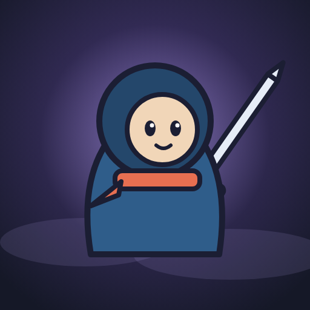

<h1 align="center">Brumeria</h1>

<b>Un jeu de chasse aux monstres tranquille, à jouer directement dans le navigateur.</b> 
Farme, équipe-toi, renais plus fort… et dissipe la brume, zone après zone.

<a href="https://frenchguyy.github.io/Brumeria/"><b>▶ Jouer à Brumeria</b></a>

---

## 🌫️ L'histoire

Une brume étrange a recouvert le royaume, et les monstres en sortent par vagues entières.
Tu incarnes un chasseur solitaire qui avance dans la brume pour la repousser, une zone à la fois.
Plus tu avances, plus les créatures sont étranges… et plus le butin est précieux.

## 🎮 Le jeu

Brumeria est un jeu **idle / farming** : ton chasseur combat tout seul, toi tu fais les bons choix.
Pas de prise de tête : tu peux jouer 2 minutes ou 2 heures, ta progression est sauvegardée automatiquement.

- **1 000 niveaux** répartis dans **10 zones**, chacune avec ses décors, sa météo, sa musique et ses monstres.
- **Des vagues de monstres** (jusqu'à 6 à la fois) et des **boss** tous les 10 niveaux.
- **Équipement complet** : arme, casque, armure, gants, ceinture, bottes, amulette.
- **6 raretés** : Commun, Rare, Épique, Légendaire, **Mythique**… et **Divin**, extrêmement rare.
- **Panoplies de classe** (Épéiste, Mage, Archer) avec bonus de set.
- **Gemmes** à sertir, **forge** et **inventaire** avec vente automatique.
- **Renaissance** : recommence plus fort et gagne des **Cristaux** pour l'**arbre de compétences**.
- **La Tour de Brume** : des étages de défis de plus en plus durs.
- **Événements**, **succès**, **titres**, **apparences**, **clans** et **classement**.
- **Vitesse ×1 / ×2 / ×4** et 3 niveaux de qualité graphique.

> Le jeu n'a pas de fin : de nouvelles zones et de nouveaux monstres arrivent avec les mises à jour.

## 📱 Jouer sur téléphone

1. Ouvre le lien **Jouer à Brumeria** sur ton téléphone.
2. Dans le menu du navigateur, choisis **« Ajouter à l'écran d'accueil »**.
3. Brumeria s'ouvre ensuite comme une vraie application, même sans connexion.

Ta sauvegarde est enregistrée **sur ton appareil** : chaque joueur a sa propre partie.

## 🎨 Création originale

Tout dans Brumeria est original : les personnages, les monstres, les décors, les icônes,
les sons et la musique sont dessinés et générés directement par le code du jeu.
Aucune image, aucun son et aucun personnage externe n'est utilisé.

---

© 2026 FrenchGuyy — Tous droits réservés.

